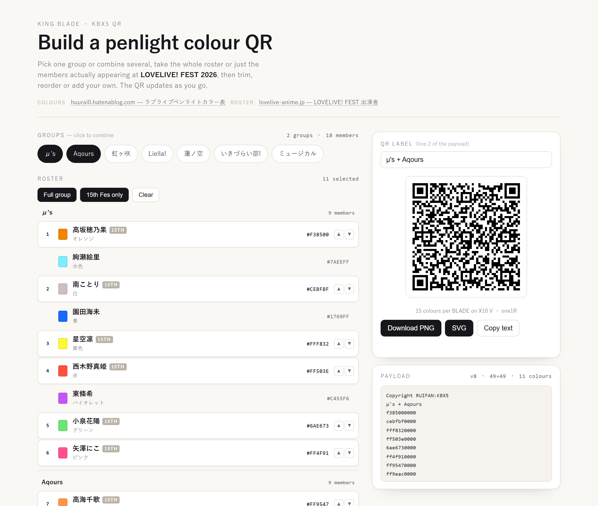

# King Blade QR — Love Live! member colours

A single-page tool that builds **King Blade (KBX5) colour QR codes** for Love Live! groups.
Pick one group — or combine several — take the full roster or only the members actually
appearing at **LOVELIVE! FEST 2026**, then trim and reorder. The QR updates live and can be
downloaded as PNG or SVG.

It opens on the 15th-Fes roster rather than an empty code, so there is always something
scannable on screen.

Live: **https://trioskosmos.github.io/LLFes2-Kingblade-QR-Generator/**



## Sources

- **Colours** — [huurai0.hatenablog.com — ラブライブペンライトカラー表](https://huurai0.hatenablog.com/entry/2026/10/05/114338).
  Every RGB value, colour name and the QR payload format come from that page.
- **Roster** — [lovelive-anime.jp — LOVELIVE! FEST 出演者](https://www.lovelive-anime.jp/special/live/live_detail.php?p=15th_lovelivefest).
- **Reference hex** — [ratius.github.io/LLS/color.html](https://ratius.github.io/LLS/color.html), official-site row, carried in `data.js` as `official`.

## Combining groups

Group pills are toggleable. Click `Aqours` while `μ's` is active and the roster shows both,
sectioned by group; the selection order follows the order you added them, and the label
auto-fills to `μ's + Aqours`. Adding a group appends its 15th-Fes members; removing one drops
its members and leaves the rest alone. `Full group` and `15th Fes only` apply across every
active group at once.

Capacity is not a concern: all seven groups together is 73 colours — 915 bytes, a version-21
code at EC level L, verified to decode.

---

## What it generates

The payload is the format King Blade's app expects. Decoded from the published codes on
[huurai0.hatenablog.com](https://huurai0.hatenablog.com/entry/2026/10/05/114338):

```
Copyright RUIFAN:KBX5
<label — free text>
<rrggbb>0000
<rrggbb>0000
...
```

- Line 1 is a fixed header.
- Line 2 is a free-text label (group name by default, editable).
- Every following line is one colour: six lowercase hex digits plus the literal `0000` padding.
- QR is **byte mode, UTF-8, EC level L**, no ECI header.

Verified: all seven codes published on that page decode with this structure, and six of them
match their colour tables line for line (the seventh, `765AS＋`, deliberately drops one of the
identical twins). Regenerating `虹ヶ咲`, `Liella!`, `蓮ノ空` or `いきづらい部!` here reproduces the
published payload **byte for byte**.

## Colours

Colours come from that page's **King Blade table**, not from the raw official-site values.
Those numbers are tuned for the LED and look deliberately dark in a browser — that is
intended, and is why a colour chip here will not match the official character colour.
Pure white is not reachable on the hardware, so the "white" members use greys
(`#9B9B9B` ノイジーホワイト, `#CEBFBF` 白, `#EFEFEF` 月白).

Each member row shows the colour name used on that page alongside the hex value.

## Roster

`15th Fes only` follows the cast list on the official
[live detail page](https://www.lovelive-anime.jp/special/live/live_detail.php?p=15th_lovelivefest).
The official page lists **6 of 9** μ's members and **5 of 9** Aqours members, so that filter
genuinely trims those two groups. Everyone else is listed in full.

## Colour limits

A King Blade stores a colour *pattern* (the app calls it a **BLADE**), not an arbitrary list,
so the length of the code is bounded by the hardware. From the sources above:

- **X10 V** and **one1R** hold **15 colours** per BLADE — the blog notes one1R went from 24
  colours down to 15, and that X10 V is "15 colours" at base with custom colours set from the app.
- **X10 V / one1B / one1RB have two memory slots**, so two patterns can be kept on the penlight
  (KingBladeBLE app description).
- The app supports **X10 Ver.3, X10 Ver.5, one1B, one1RB**.
- Every code published on that page tops out at **14 colours**, which fits.

The tool shows a quiet capacity line under the QR, an amber warning past 15 colours, and a red
one past 30. It cannot detect what your specific unit stores — 15 is the documented figure, and
some models are reported to hold more, so treat anything above 15 as unverified.

## Files

| file | purpose |
|---|---|
| `index.html` | markup |
| `styles.css` | styling |
| `app.js` | UI state, multi-group selection, payload assembly, PNG/SVG export |
| `qr.js` | dependency-free QR encoder (byte mode, versions 1–40, L/M/Q/H) |
| `data.js` | generated roster: names, colour names, hex, 15th-Fes flag |

No build step, no network calls, no dependencies. Opening `index.html` from disk works.

## Updating

This folder *is* the repo — GitHub Pages serves `main` from the root.

```bash
cd site
# edit files, then
git add -A && git commit -m "…" && git push
```

Pages rebuilds automatically, usually within a minute.

## Regenerating `data.js`

`data.js` is generated from the source pages by `build_data.py` in the parent project
(`build_data.py` → `site/data.js`), which merges:

- the King Blade colour tables from the blog post above,
- official-site hex values from `ratius.github.io/LLS` (for reference),
- the 15th Fes cast list from the official live page.

Re-run it after editing any of `src/blog_colors.json`, `src/color.json` or `src/fes.html`.

## Verification

`qr.js` was checked by generating codes and decoding them back with ZXing: 11/11 payloads
round-trip exactly, including all seven real-world ones, and all seven group presets generated
from this page decode to their exact payload.
